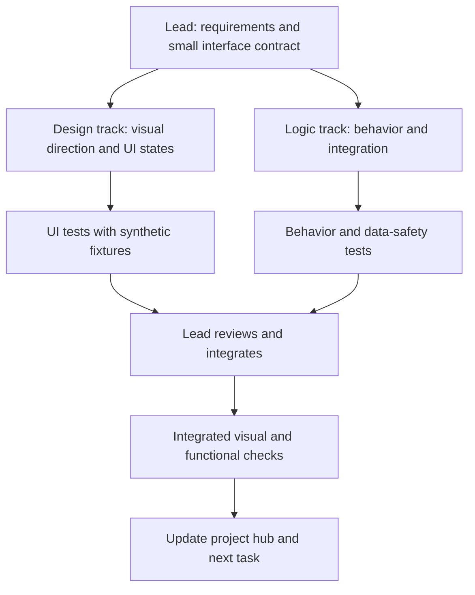

# Development and design orchestration

**Status:** Planning and tool investigation; no production implementation started. Updated 6 November 2026.  
**Project status:** [Project hub](project-hub.md). **Product requirements:** [First-release plan](first-release-plan.md). **Product context:** [PRODUCT.md](../PRODUCT.md).

## Roles requested by the user

- **Lead and integration:** Codex coordinates the work, defines scoped tasks and interfaces, reviews evidence, handles integration, and keeps the project hub current.
- **Implementation:** Use Antigravity's `gemini-4-argon-medium` for focused implementation tasks when actually available to the account. `agy models` listed it on this machine; a listing is not proof that every future request will succeed.
- **UI testing:** Use Antigravity's `gemini-3.8-flash-high` to drive Agent Desktop when practical. Agent Desktop is a computer-use tool, not a model. Verify that the model, tool, session permissions, and the intended test environment actually work together.
- **Design references:** Use the user-requested GradientDeck UI and Unslop as design inputs/review tools after confirming the exact projects. [GradientDeck UI](https://ui.gradientdeck.com/) provides a catalog of design references. Multiple GitHub projects are named Unslop, including [heydamir/unslop](https://github.com/heydamir/unslop) and [claudiusararu/unslop-ui-skill](https://github.com/claudiusararu/unslop-ui-skill); the intended one is not yet confirmed. Do not install a lookalike or copy third-party assets without checking provenance and applicable terms.

The requested separation means agents receive focused responsibilities. A functioning product still needs an agreed interface between them and an integration pass; independent work must not silently change a shared contract.

## Proposed workflow

1. **Define one user-visible slice.** Specify the input, output, loading, empty, success, error, and approval states the user should see. Establish a minimal typed contract or fixture before parallel changes; identify file ownership and the integration point.
2. **Design track.** Explore dashboard-specific directions using Impeccable and confirmed user-selected references. A design agent focuses on layout, typography, interactions, accessibility, and responsive desktop behavior, using synthetic data and fixtures. It does not implement persistence or external integrations.
3. **Logic track.** An implementation agent focuses on the agreed behavior, data ownership, error handling, and tests behind the contract. It does not redesign the UI. Separate tasks can cover AGY, FlowState, and Obsidian when their dependencies and safe data boundaries are ready.
4. **Isolate parallel work.** Use separate Worktrunk-managed Git worktrees/branches for tasks that do not conflict. Both tracks start from the same agreed base and contract. Create a worktree only in the appropriate project repository, with hooks understood or disabled for the test; shared app data, ports, credentials, and external files still need isolation. A worktree does not automatically isolate those resources.
5. **Inspect and integrate.** The lead reviews the diff and actual behavior, resolves contract changes or conflicts explicitly, integrates into a shared branch, and tests the combined result. Don't merge into a release or remove another agent's work without checking its state.
6. **Test the real surface.** Run Agent Desktop driven by the requested model on an isolated test instance, including screenshots, keyboard navigation, error and empty states, and the user's relevant Windows screen sizes. Confirm the visual result rather than relying only on code or an agent's report. Check interaction and data behavior together after integration.
7. **Record progress.** Update [the project hub](project-hub.md) with status, evidence, changed decisions, and a short handoff. Document actual model/tool use; do not report intended assignments as completed work.

## Machine-specific findings

- Antigravity's installed model list includes `gemini-4-argon-medium` and `gemini-3.8-flash-high`. The latter was invoked successfully in the synthetic test below. Argon Medium's listing does not establish successful implementation use; test it when a suitable implementation task is ready.
- Worktrunk is installed as `git-wt` version 0.81.0. In a disposable Git repository, two worktrees created with hooks disabled kept separate synthetic UI and logic changes isolated from each other and the baseline. On this Windows machine bare `wt` resolves to Windows Terminal first, so prefer the verified `git-wt` executable. The dashboard planning folder is not currently a Git repository; choose the actual project location before creating project worktrees. The existing FlowState repository has uncommitted work and must be preserved.
- Agent Desktop version 1.1.0 reported a permissions/DACL error in its default state directory. A fresh, separate `AGENT_DESKTOP_HOME` in the test workspace allowed status and UI access without modifying the default state. In a synthetic end-to-end check, actual AGY `gemini-3.8-flash-high` called a narrowly scoped test MCP adapter to observe and click a synthetic Windows form through Agent Desktop. An independent snapshot confirmed the form changed from waiting to complete. This validates a minimal model/tool interaction through the test adapter, not direct shell-driven Agent Desktop, screenshot review, or evaluation of the real dashboard.
- Test files are retained under `work/agent-desktop-proof` and `work/worktrunk-proof`. The UI-test adapter embeds that run's window ID and must be updated for a new window; it is not a reusable production integration. Test processes were stopped. A synthetic AGY conversation and trust for the test workspace may remain in AGY history/settings.
- The requested visual direction is not yet selected. A copied `DESIGN.md` from an unrelated website is inspiration, not proof that its interface suits a focus dashboard. Preserve the user's chosen visual constraints and test the real task flow.

## Initial work slices after the plan and UI direction are reviewed

1. **Shared foundation:** Choose the dashboard repository and shell; record data ownership, storage, and a small UI/logic contract. Keep existing FlowState changes intact.
2. **First UI slice:** Dashboard start screen with a few suggested actions, continue session, quick capture, and representative loading/empty/error states using synthetic fixtures.
3. **First logic slice:** Goals/projects/capture and session state behind the agreed interface, with behavior tests and no visual redesign.
4. **Integration slices:** Actual AGY terminal and project-aware MCP; FlowState stop and synchronization; approved Obsidian reviewer flow; memory and practice. Preserve every first-release requirement in the plan and coordinate dependencies before parallelizing.
5. **Release review:** Run the first-release walkthrough, including recovery, security, usability, keyboard access, and tested data boundaries; compare rendered screens against the selected design direction.

## Open decisions

- Which exact Unslop and GradientDeck projects the user intends, and which reference examples they want to use.
- Dashboard project/repository location and Windows packaging. The React/TypeScript/Vite + Electron/Node stack direction was accepted; D: is an unstable external HDD and not suitable for development.
- The contract and file ownership for the first parallel slice, and the chosen UI direction.
- Agent Desktop's ability to inspect the eventual dashboard, capture and assess screenshots under the user's chosen AGY model, and operate safely as a reusable development workflow. A simple isolated form action has passed; the actual design review remains untested.
- Production-safe FlowState communication, Obsidian file recovery, memory limits, and other integration decisions in the [first-release plan](first-release-plan.md).
