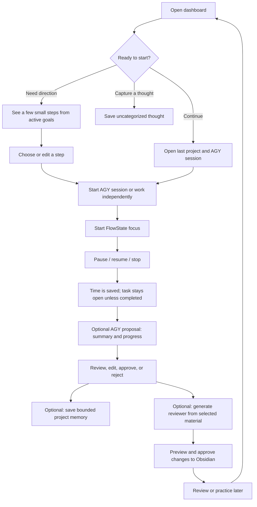
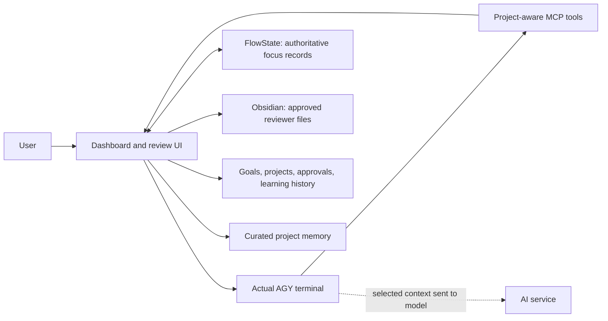

# Personal Command Center — first-release plan

**Status:** Draft for review, 6 November 2026. This is a planning artifact, not an implemented application or an instruction to start building.  
**Navigation and progress:** [Project hub](project-hub.md).  
**Evidence:** [Latest integration prototypes](end-to-end-prototype-results.md), [earlier AGY results](antigravity-feasibility-results.md), and [planning decisions](dashboard-decisions.md).

## 1. Problem and outcome

The user has many ideas, school responsibilities, projects, and learning goals but struggles to decide where to begin. Existing note and productivity apps are rarely opened; another complicated system could make the problem worse. AI is useful for work and writing, but the user also wants to retain knowledge and become able to do more independently.

The app should make it easy to start one meaningful session, capture thoughts without organizing them immediately, and later see what was done and practiced. It is Windows/PC-first. A good first release is something the user actually wants to open when starting work or study, with thoughtful UI and minimal friction.

## 2. First-release journey

Independent work and focus must remain usable if AGY or the network is unavailable. AI-generated descriptions require sufficient available context; the app must show uncertainty or ask rather than invent work.

## 3. Required behavior

### 3.1 Start screen and quick capture

- Show a few manageable suggested actions across user-selected active goals, with a reason for each. Let the user choose, edit, dismiss, or request alternatives. An optional time/energy prompt is skippable; the app remains usable without it.
- Provide **Continue last session**, and make projects and AGY sessions reachable in one click from the dashboard.
- Provide quick capture for a thought, task, concern, or note without requiring a category. The item can remain uncategorized or later be attached to a project or goal.
- Allow selecting goals from the existing backlog or creating new ones. Preserve the rest of the backlog; do not treat all 72 captured items as active obligations or silently import them as tasks.
- Archived projects and archived goals are excluded from default active suggestions. Archiving each is independent, reversible, and preserves its history.

### 3.2 Goals and projects

- Create and manage active goals, optional finish lines, milestones/checklists, and progress notes. Time spent and progress toward completion are separate values.
- Support a project linked to a real folder and a project without an existing folder, such as personal study. Associate relevant goals, sessions, and notes without requiring every captured thought to have a project.
- Let AGY propose goal progress or milestone changes. Present changes for review, editing, approval, or rejection before applying them.
- Show prior sessions and completed work in context, including tasks left open. Do not equate time spent with goal completion.

### 3.3 AGY sessions and project memory

- Host the actual installed AGY CLI in an app terminal, with dashboard UI around it. Support project folders and sessions within projects, a way to return to a prior session, and the user's compatible existing AGY skills and plugins.
- Provide a dedicated, project-aware MCP integration. Tools expose only the actions and context needed for the selected workflow, and report the actual outcome, including denied requests and failures. A visible slash command does not guarantee the model called the tool.
- Project memory is distinct from full AGY transcripts, approved session summaries, learning history, and Obsidian reviewers. User explicitly chooses to save a session's important details; show the proposed change and get approval before changing memory. Suggested deduplication or consolidation must be reviewable and may be imperfect.
- Bound the curated memory supplied to AI. Do not silently delete full notes or session history to fit the limit. The budget, overflow and consolidation behavior remain design decisions.
- The user permits cross-project suggestions using memory from **active** projects. Archived projects are excluded by default. Show what material is provided to the AI and which project it came from; ordinary project work stays scoped to its selected context unless explicitly authorized.
- The installed CLI and available context are external dependencies: report an unavailable CLI, failed session restore, missing context, or denied action honestly. Do not claim a session resumed or an action completed until confirmed.

### 3.4 FlowState and focus

- FlowState development and integration are required in the first usable release. The user can start and stop through `/focus` and `/stop` or an unambiguous natural-language request; ambiguous requests require clarification. A clear failure must be shown if a tool call or FlowState action fails.
- Support work without AGY: start, pause, resume, and stop directly in FlowState, with a manual note after the session. AGY summaries are optional.
- Paused time does not count as active work. Stopping saves the session and actual FlowState duration while leaving an unfinished task open; completing a task is a separate choice.
- Focus sessions started directly in FlowState should appear in the dashboard, including sessions finished while the dashboard was closed. A durable session identity and reconciliation must prevent duplicate records after reconnect/restart.
- After a session, AGY may propose the intention, work completed, learning, and next step from context it can actually access. Show uncertainty and require approval before applying proposed updates to goals, learning history, or memory. FlowState, not the model, supplies elapsed time.
- Handle unavailable FlowState, an existing active session, duplicate commands, paused/restarted applications, and interruptions without falsely reporting success or losing session data.

### 3.5 Obsidian reviewers

- From an AGY study session, create a reviewer for the user's existing Obsidian vault. The user chooses the subject/project and may select additional study sources. AGY proposes the content, destination, and any links; the user previews and approves before changes are written.
- Preserve existing note content, frontmatter, links, and formatting. Detect external changes between proposal and save, and require refreshed review rather than silently overwriting. Handle new-file collisions and provide recovery for interrupted multi-file changes.
- The user can open and read the approved reviewer in Obsidian and use it as a source for a later AGY practice session. Existing vaults vary; do not assume every file uses the sampled structure or index the entire vault without a choice.
- The exact file placement, links, safe write/recovery technique, and test path for the user's vault are not yet decided. Test against disposable vaults before working with real material.

### 3.6 Learning history and practice

- Maintain a reviewable history of studied topics, completed work, and independent practice. Distinguish studied from practiced; do not infer mastery from an AI-written note or elapsed time.
- Through AGY in the first release, start **multiple-choice**, **interview**, or **hands-on** practice based on selected prior learning, a project, a session, or reviewer. A dedicated quiz UI is not required initially.
- Offer feedback after each answer or at the end; default to after each answer.
- After practice, AGY proposes a history update covering what was practiced, progress, struggles, and possible patterns. The user may review, edit, approve, or reject it. Label patterns as tentative and connect them to relevant sessions where available.

## 4. Data, safety, and operational boundaries

This diagram shows responsibilities, not a final technology or process architecture. The FlowState bridge in the experiment was unauthenticated and is not suitable for release. Select and test an appropriate protected local communication mechanism; do not manipulate the running app's database behind its in-memory timer.

Proposed ownership: FlowState owns focus session IDs and authoritative time; the dashboard owns its goals, project links, pending approvals, and learning history; Obsidian-compatible Markdown holds user-readable reviewer content. Exact ownership of session summaries and project memory, and how local data is stored, require a recorded design decision. Avoid two competing authoritative copies of the same focus record.

Backups and restoration must cover the user's relevant structured records and user-readable notes, and the relationship to FlowState and the selected vault. Define what is backed up, when, and how restore is tested before relying on it. Show what content is sent to an AI service; local storage does not automatically mean private or encrypted. Avoid unnecessary collection and use disposable/synthetic data for tests.

## 5. Failure behavior to design and verify

| Situation | Required behavior |
|---|---|
| AGY or network unavailable | Quick capture, local information, and independent FlowState focus remain usable; AI features show why unavailable. |
| CLI command or tool fails, is denied, or calls an unexpected tool | Show the actual result; do not report a timer or save as successful. Avoid unintended actions; obtain clarification where needed. |
| FlowState already has a session, is closed, or either app restarts | Show the real state, avoid duplicate starts/stops, and reconcile sessions using durable identity. A stopped session's unfinished task remains open. |
| Available session context is incomplete or compacted | Say what context was available; request missing details or leave them blank, never invent a summary or learning result. |
| Reviewer target changed, was created elsewhere, or a save is interrupted | Preserve the external edit, stop and re-review on conflict; define and test recovery from partial changes. |
| Memory limit reached | Offer a reviewed consolidation or choice of what context to include; preserve original history and do not silently discard content. |
| Project or goal archived | Preserve and allow restoring it; exclude archived material from ordinary active suggestions by default. |

## 6. Release acceptance walkthrough

Use synthetic data and isolated storage for automated and destructive/error-path checks. Only test against the user's existing applications or vault with a deliberate safe-data and recovery procedure.

1. Create or select an active goal, capture an uncategorized thought, and choose or edit a suggested next step. Archive and restore a separate goal/project; verify excluded suggestions and retained history.
2. Start the actual AGY CLI in the dashboard, open a project/session, use a compatible skill and project-aware MCP, close and resume it, and correctly display failure if a resume or tool action does not work.
3. From AGY, start focus; pause and resume; stop without completing the task. Verify actual FlowState time and session ID, a separate complete-task action, and that repeated commands do not create duplicate records.
4. Start and finish a session directly in FlowState with AGY unavailable and the dashboard closed; reopen and verify that session is discovered once with its real duration and manual note. Exercise restart and interrupted-write cases.
5. Review an AGY-generated progress or learning proposal, reject one and approve another. Confirm rejected updates change nothing and approved updates appear in the correct project/goal and preserve uncertainty.
6. Explicitly request project memory, review a proposed change, and approve or reject it. Verify project boundaries, the agreed size budget, retention of original notes, and the user's permission for active-project cross-suggestions with archived projects excluded.
7. Generate a reviewer from a study session and optional selected sources. Reject a proposal with no vault changes; approve a fresh one; verify content and links in Obsidian. Repeat with an external edit, new-file collision, and interrupted save; verify no silent overwrite and a tested recovery path.
8. Start multiple-choice, interview, and hands-on practice from prior learning. Check both feedback timing choices and review an evidence-linked proposal for progress, struggles, and tentative patterns without claiming mastery.
9. Back up and restore representative structured data and user-readable notes. Verify links/associations, reasonable keyboard access, readable states, and that Windows restart and application failure paths are understandable.

These are desired release checks, not claims that the existing prototypes already pass them. Detailed automated tests should focus on observable behavior, particularly data protection and cross-application recovery.

## 7. Delivery sequence

See the [project hub](project-hub.md) for checkpoint statuses and dependencies. Start with reviewing this plan and comparing UI directions. In parallel with design exploration, settle project location, shell, data ownership, and recovery boundaries before committing to implementation. Build the dashboard foundation and actual AGY integration, then develop FlowState and Obsidian integrations and add memory and practice. Finish with a complete integrated Windows walkthrough. Some work can overlap when its dependencies are met; no day-one integration is postponed beyond the first usable release.

## 8. Decisions still open

These are not silently settled by this plan:

1. **Dashboard home and technology:** The user accepted React/TypeScript/Vite and Electron/Node, with SQLite and Markdown, while FlowState retains Tauri/Rust. The new project's location, dependency versions, packaging, and relationship to the existing FlowState repository remain open. D: is an unstable external HDD and is not suitable for development; use reliable internal storage.
2. **Identity and synchronization:** Stable IDs, how FlowState-only sessions are discovered after downtime, handling retries/concurrent requests, and exact ownership of summaries versus raw focus records.
3. **Project data and memory:** Location and format of project notes versus existing vault/code folders, the memory budget and unit, what context is available after AGY compaction, and a safe backup/restore strategy.
4. **Obsidian changes:** Destination selection, supported link style, safe conflict detection and recovery for multiple files, and a deliberate way to test compatibility with the user's existing structure.
5. **UI direction:** The visual style, dashboard arrangement, and how terminal, session history, review, and focus status coexist without overwhelming the user. Compare several directions before selecting one.
6. **Integration constraints:** Secure local communication, packaging, permissions, supported AGY session resume behavior and account eligibility for the exact arrangement. Existing prototypes prove narrow behavior, not production security or all provider-policy interpretations.

Make routine implementation choices with evidence and keep the user involved when a choice changes the workflow, data, or appearance. Update the project hub when a decision is made.

## 9. Later, not removed

Gemini Notebook API integration is deferred while capabilities evolve; the current approach uses AGY-generated reviewers with Obsidian. A scheduled check for meaningful Notebook API changes already exists. Multi-client management, invoices, and collaboration are future ideas rather than first-release requirements. The backlog remains available without forcing every idea into the first release.
