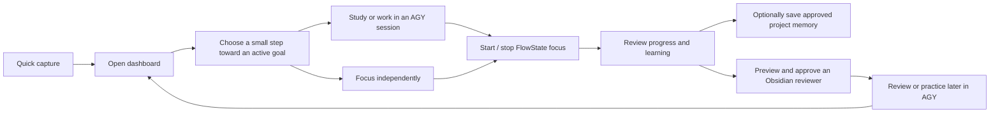
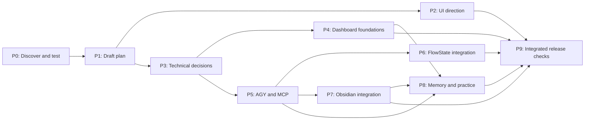

# Personal Command Center — project hub

> **Current handoff, 6 November 2026:** The user chose the Codex design, now on `main`, and the competing UX branches were removed. The first release should support both installed AGY and OpenCode. A standalone, unpackaged [terminal foundation](../work/tgm-terminal/README.md) exists; it is not yet connected to the dashboard. See the [harness feasibility report](harness-feasibility-2026-11-06.md) for test results and the detached-process limitation. Older comparison and AGY-only notes below are historical where they conflict with this handoff.

**Last updated:** 6 November 2026  
**Current stage:** First-release plan drafted; product context and design/development orchestration in progress.  
**Product implementation:** Not started. Earlier code was used for disposable feasibility tests.

This is the short starting point for the user or a future agent. Read the [first-release plan](first-release-plan.md) for requirements, failure handling, acceptance checks, and unresolved decisions; [development orchestration](development-orchestration.md) captures the requested design/logic split and tool evidence. The [stack decision](stack-decision-proposal.md) records the accepted direction and remaining tests. [PRODUCT.md](../PRODUCT.md) holds durable product context. The [decisions and open checks](dashboard-decisions.md) preserve the discussion; the [prototype results](end-to-end-prototype-results.md) document the most recent experiments. Where an older verification note appears to conflict with a later test, use the dated result and retain the remaining limitations.

## What the app is for

Help the user start a real work or study session when they feel overwhelmed, remember what they have done, and develop independent skills. The first usable Windows release combines a calm dashboard, the actual AGY CLI, the user's FlowState app, and their Obsidian reviewer library.

FlowState must also work without AGY. An Obsidian reviewer and a memory update are optional per session, but both integrations are required in the first release. All three practice formats—multiple choice, interview, and hands-on—are available through AGY in that release.

## Progress and checkpoints

Status meanings: **Done** = supported by the linked evidence; **In progress** = actively being worked on; **Not started** = no production work yet; **Blocked** = cannot proceed until a named external condition is resolved. A prototype pass does not complete an implementation checkpoint. Do not estimate percentages without evidence.

| ID | Checkpoint | Status | Depends on | Completion evidence |
|---|---|---|---|---|
| P0 | Record product decisions and run focused feasibility probes | Done | — | [Decisions](dashboard-decisions.md); [prototype results](end-to-end-prototype-results.md) |
| P1 | Draft first-release plan and visual project map | Done | P0 | [First-release plan](first-release-plan.md); this hub. Draft, not user-approved specification. |
| P2 | Review scope and explore desktop UI/UX directions | In progress | P1 | User chose the Loki-inspired TGM direction; 6 parallel Worktrunk (`git-wt`) UX & animation variations + [Comparison Arena](ux-arena/index.html) await user evaluation alongside the [original seed](tgm-ux-prototype/index.html). See [UX discovery](ux-shaping-draft.md). |
| P3 | Choose dashboard project location, app shell, ownership, storage, and recovery approach | In progress | P1; UI informs shell | [Stack direction accepted](stack-decision-proposal.md); project location, ownership and safe FlowState/vault integration remain open. D: is an unreliable external HDD and must not be used for development. |
| P4 | Build dashboard foundations: goals, projects, capture, and session history | Not started | P3 | Acceptance checks in the plan pass with restart and test data. |
| P5 | Integrate the actual AGY terminal, project sessions, MCP, and approvals | Not started | P3 | Packaged Windows workflow tested; failures and scope boundaries visible. |
| P6 | Develop FlowState stop, integration, and reconciliation | Not started | P3, P5 | Direct and AGY-started sessions work; timing, duplicate prevention, and recovery checks pass. |
| P7 | Integrate reviewed Obsidian reviewer saving | Not started | P3, P5 | Approved changes, conflict handling, backup/recovery, and opening in Obsidian verified. |
| P8 | Add bounded project memory, learning history, and all three practice modes | Not started | P4, P5; reviewer path P7 | Approval, project scope, practice, and history checks pass. |
| P9 | Finish integrated usability, security, recovery, and release checks | Not started | P2, P4–P8 | First-release acceptance walkthrough and agreed tests pass on Windows. |

The dependency arrows show what must exist to finish a checkpoint. UI exploration and technical investigation may overlap; the graph is not permission to omit any first-release integration.

## Current handoff

- **6 November Codex concept:** A seventh, independently designed synthetic preview is in the `ux-codex` worktree and the [comparison arena](ux-arena/index.html). It explores compact suggestions, independent focus, shared capture and review before saving. The user has not yet evaluated it; real AGY, FlowState and Obsidian integrations remain out of scope for this prototype.
- **6 November design audit:** The six Flash UX variations received separate visual-design and usability grades in the [comparison audit](ux-design-audit-2026-11-06.md). The review recommends Discovered Skills as a starting point, subject to the user's own evaluation; it identifies concrete focus/task, keyboard and contrast defects that need correction before treating any variant as a foundation. These are synthetic previews, not production integrations.
- **6 November UX & Animation Arena (Worktrunk):** Per user request, 6 isolated Worktrunk (`git-wt`) branches/worktrees (`work/ux-variations/*`) were created from `master` and built in parallel by 6 Gemini 3.8 Flash subagents across three comparison groups (direct `agy --model gemini-4-argon-high` CLI runs hit `429 RESOURCE_EXHAUSTED` quota limits, and their `argon-ux-*` branches were removed per user request):
  1. **Installed UX Skills:** `ux-impeccable` (`7f080e6`, using `impeccable` `animate`/`delight`/`polish`/`craft-floor`), `ux-pro-max` (`a8b5d50`, using `ui-ux-pro-max` + `high-end-visual-design`), and `ux-taste-motion` (`b9a76c0`, using `design-taste-frontend` + `stitch-design-taste`).
  2. **Discovered UX Skills & Benchmarks:** `ux-discovered-skills` (`6e8f83c`, discovered `.agents/skills` `animate`, `design-system`, `motion-graphics`, and `obsidian-markdown`) and `ux-open-design-benchmark` (`4233a40`, mined `open-design` Raycast/Linear/Cursor/Obsidian split-pane patterns).
  3. **No-Skills Control Group:** `ux-baseline-noskills` (`d895cca`, built by a custom `vanilla-no-skills-agent` with zero `SKILL.md` access).
  All 6 variations address the earlier preview gaps (Home-started independent FlowState focus, Stop-session vs. Complete-task separation, Workspace Quick Capture, interactive AGY CLI simulation with tool-approval gate, and verified-facts vs. AI-proposal review) and can be evaluated side-by-side or in blind mode via the [TGM UX & Animation Arena](ux-arena/index.html).
- **Next:** User evaluates the 6 parallel variations in the [UX & Animation Arena](ux-arena/index.html) (or individual worktrees) to pick the winning UX/animation direction or combine favorite traits before locking the P3 UI/logic interface contract.
- **Already demonstrated:** Actual AGY `/focus` and `/stop` controlled a modified, isolated FlowState copy; the stop saved time without completing the test task. AGY also submitted an Obsidian reviewer proposal via MCP. See the [test report](end-to-end-prototype-results.md) for precise boundaries.
- **Not yet demonstrated:** A packaged, secure dashboard with the real user vault, reliable recovery, and all features working together. A prototype bridge is unauthenticated and must not be shipped as-is.
- **Protect:** The user's existing FlowState data and Obsidian vault. Use isolated test data until a specific safe real-data path has been reviewed.
- **Decide:** Dashboard repository, data ownership and sync, memory budget, backup/recovery, and exact reviewer save/link strategy. Electron 45's renderer crash is unexplained; packaging and supported-version verification remain open. These remain proposals or open questions in the plan.
- **Deferred:** Gemini Notebook API integration and multi-client business features; keep the agreed first-release scope intact.

## How to keep this useful

At the end of each meaningful checkpoint, update this file's date, status, dependencies if changed, and a link to concrete evidence. Replace the handoff bullets with the current next action, verified facts, open risks, and any changed user decisions. Keep detailed requirements in the first-release plan instead of copying them into every update. Record new decisions with their date and rationale; never mark a feature done solely because a prototype passed. Preserve earlier test reports as dated evidence.

For a fresh agent session, a concise starting instruction is: **“Read the project hub and its current handoff, then use the linked plan and evidence relevant to the next checkpoint. Update the hub when finished.”**
