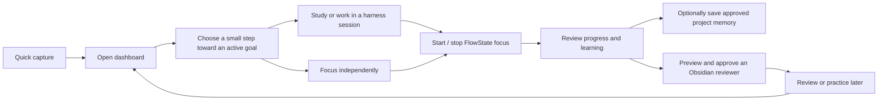
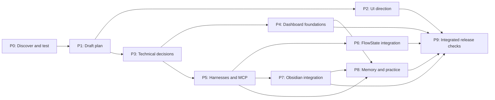

# Personal Command Center — project hub

> **Review-branch handoff, 7 November 2026:** This branch preserves the Home implementation and safety fixes separately from `main`, at the user’s request. Do not merge its design or artifacts into `main` by default. Goal edits detect conflicting writes, and unsaved Home drafts are protected on close. Backup and recovery create verified database copies in unique subdirectories; they do not replace the live database. See [recovery instructions](../app/README.md#database-backup-and-recovery) for the remaining concurrency limits.

> **Earlier Home handoff, 7 November 2026 (first slice integrated and verified):** The first implementation slice ([GitHub issue #1](https://github.com/AlwinsonTGM/TGM/issues/1), split into `#2`–`#5`) is implemented and verified on `codex/tgm-home-slice` under [`app/`](../app/README.md). It delivers:
> - Local uncategorized quick capture (`#2`) and local active goals with optional first steps, derived next-step suggestions, and non-mutating detail review/editing (`#3`) backed by Node 24 `node:sqlite` (`captures.sqlite` in Electron `userData`).
> - Honest session and integration availability (`#4`) via `SessionStatus` and `useSession`, keeping `Continue last session` prominent when a controlled session provider supplies a session (preserving original `AGY` / `OpenCode` harness identity and awaiting actual resume confirmation) while reporting session continuation, FlowState, AGY, OpenCode, and Obsidian as not connected in the default build.
> - A verified SQLite snapshot/restore CLI (`app/scripts/recover-database.cjs`), 21 automated Electron/Playwright and recovery tests (`npm test`), and an Impeccable static + live CDP audit with zero detector findings (`#5`).
> - **Next:** Review `codex/tgm-home-slice` for merge to `main`, decide packaged app data location, and proceed to the remaining first-release slices (connecting the multi-harness terminal foundation, FlowState focus start/stop reconciliation, reviewed Obsidian vault writes, bounded project memory, and practice modes).

> **Earlier handoff, 7 November 2026:** The user confirmed the [Home first-slice brief](home-slice-brief.md): prioritize Continue when a session exists, keep suggested next steps visible, and provide locally saved goals and uncategorized quick capture. Add goals through a short Home form with an optional first step; selecting a suggestion opens its goal and step details. The selected Codex concept is the visual starting point, captured as prototype-derived guidance in [DESIGN.md](../DESIGN.md). The dashboard source will live in `app/` in this project and repository; FlowState remains separate.

> **Earlier handoff, 6 November 2026:** The user chose the Codex design, now on `main`, and the competing UX branches were removed. The first release should support both installed AGY and OpenCode. A standalone, unpackaged [terminal foundation](../work/tgm-terminal/README.md) exists; it is not yet connected to the dashboard. See the [harness feasibility report](harness-feasibility-2026-11-06.md) for test results and the detached-process limitation. Older comparison and AGY-only notes below are historical where they conflict with this handoff.

**Last updated:** 7 November 2026

**Current stage:** Home first implementation slice (`#1`–`#5`) built and verified in `app/`; external harness, FlowState, and Obsidian integrations remain next.  
**Product implementation:** In progress (`app/` on `codex/tgm-home-slice`).

This is the short starting point for the user or a future agent. Read the [first-release plan](first-release-plan.md) for requirements, failure handling, acceptance checks, and unresolved decisions; [development orchestration](development-orchestration.md) captures the requested design/logic split and tool evidence. The [stack decision](stack-decision-proposal.md) records the accepted direction and remaining tests. [PRODUCT.md](../PRODUCT.md) holds durable product context. The [decisions and open checks](dashboard-decisions.md) preserve the discussion; the [prototype results](end-to-end-prototype-results.md) document the most recent experiments. Where an older verification note appears to conflict with a later test, use the dated result and retain the remaining limitations.

## What the app is for

Help the user start a real work or study session when they feel overwhelmed, remember what they have done, and develop independent skills. The first usable Windows release combines a calm dashboard, the actual AGY and OpenCode CLIs, the user's FlowState app, and their Obsidian reviewer library.

FlowState must also work without a harness. An Obsidian reviewer and a memory update are optional per session, but both integrations are required in the first release. All three practice formats—multiple choice, interview, and hands-on—are available in that release.

## Progress and checkpoints

Status meanings: **Done** = supported by the linked evidence; **In progress** = actively being worked on; **Not started** = no production work yet; **Blocked** = cannot proceed until a named external condition is resolved. A prototype pass does not complete an implementation checkpoint. Do not estimate percentages without evidence.

| ID | Checkpoint | Status | Depends on | Completion evidence |
|---|---|---|---|---|
| P0 | Record product decisions and run focused feasibility probes | Done | — | [Decisions](dashboard-decisions.md); [prototype results](end-to-end-prototype-results.md) |
| P1 | Draft first-release plan and visual project map | Done | P0 | [First-release plan](first-release-plan.md); this hub. Draft, not user-approved specification. |
| P2 | Review scope and explore desktop UI/UX directions | In progress | P1 | Codex concept selected; [Home brief](home-slice-brief.md) and [visual guidance](../DESIGN.md) implemented for Home in [`app/`](../app/README.md) and verified via Impeccable audit. Broader release screens remain. |
| P3 | Choose dashboard project location, app shell, ownership, storage, and recovery approach | In progress | P1; UI informs shell | [Stack direction accepted](stack-decision-proposal.md); dashboard source in `app/` with Electron + `node:sqlite` (`captures.sqlite`) and verified snapshot/restore CLI (`app/scripts/recover-database.cjs`). Packaged data location and safe FlowState/vault integration remain open. |
| P4 | Build dashboard foundations: goals, projects, capture, and session history | In progress | P3 | First Home slice (`#1`–`#5`) passes 21 automated Electron and recovery checks across restarts and failure states. Real session history provider and project archival UI remain. |
| P5 | Integrate the actual AGY and OpenCode terminals, project sessions, MCP, and approvals | Not started | P3 | Packaged Windows workflow tested; failures and scope boundaries visible. |
| P6 | Develop FlowState stop, integration, and reconciliation | Not started | P3, P5 | Direct and harness-started sessions work; timing, duplicate prevention, and recovery checks pass. |
| P7 | Integrate reviewed Obsidian reviewer saving | Not started | P3, P5 | Approved changes, conflict handling, backup/recovery, and opening in Obsidian verified. |
| P8 | Add bounded project memory, learning history, and all three practice modes | Not started | P4, P5; reviewer path P7 | Approval, project scope, practice, and history checks pass. |
| P9 | Finish integrated usability, security, recovery, and release checks | Not started | P2, P4–P8 | First-release acceptance walkthrough and agreed tests pass on Windows. |

The dependency arrows show what must exist to finish a checkpoint. UI exploration and technical investigation may overlap; the graph is not permission to omit any first-release integration.

## Current handoff

- **7 November Home first implementation slice (`#1`–`#5`):** Built across isolated worktrees (`codex/tgm-home-capture`, `codex/tgm-home-goals`, `codex/tgm-home-sessions`, `codex/tgm-home-qa-planning`) and integrated on `codex/tgm-home-slice`. Orchestrated between Codex (frontend design, architecture, worktree integration) and Gemini 4 Argon Medium (`agy --model gemini-4-argon-medium` for SQLite repository logic, session state hook, recovery CLI, test cases, and completion in Antigravity after Codex quota ran out). All 21 automated tests pass (`npm test` in `app/`).
- **Already demonstrated:** Actual AGY `/focus` and `/stop` controlled a modified, isolated FlowState copy; the stop saved time without completing the test task. AGY also submitted an Obsidian reviewer proposal via MCP. See the [test report](end-to-end-prototype-results.md) for precise boundaries.
- **Not yet demonstrated:** Connecting the standalone terminal foundation (`work/tgm-terminal`), FlowState, and Obsidian to `app/`, or packaging a production installer.
- **Protect:** The user's existing FlowState data and Obsidian vault. Use isolated test data until a specific safe real-data path has been reviewed.
- **Decide:** Final packaged data location, memory budget, and exact reviewer save/link strategy.

## How to keep this useful

At the end of each meaningful checkpoint, update this file's date, status, dependencies if changed, and a link to concrete evidence. Replace the handoff bullets with the current next action, verified facts, open risks, and any changed user decisions. Keep detailed requirements in the first-release plan instead of copying them into every update. Record new decisions with their date and rationale; never mark a feature done solely because a prototype passed. Preserve earlier test reports as dated evidence.

For a fresh agent session, a concise starting instruction is: **“Read the project hub and its current handoff, then use the linked plan and evidence relevant to the next checkpoint. Update the hub when finished.”**
