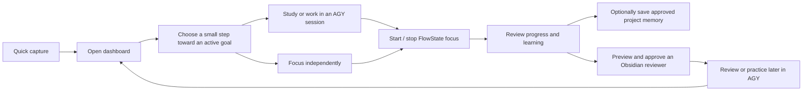
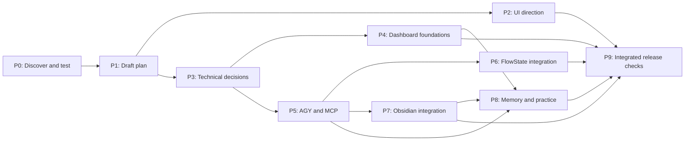

# Personal Command Center — project hub

**Last updated:** 6 November 2026  
**Current stage:** First-release plan drafted; product context and design/development orchestration in progress.  
**Product implementation:** Not started. Earlier code was used for disposable feasibility tests.

This is the short starting point for the user or a future agent. Read the [first-release plan](first-release-plan.md) for requirements, failure handling, acceptance checks, and unresolved decisions; [development orchestration](development-orchestration.md) captures the requested design/logic split and tool evidence. The [stack decision](stack-decision-proposal.md) records the accepted direction and remaining tests. [PRODUCT.md](../PRODUCT.md) holds durable product context. The [decisions and open checks](dashboard-decisions.md) preserve the discussion; the [prototype results](end-to-end-prototype-results.md) document the most recent experiments. Where an older verification note appears to conflict with a later test, use the dated result and retain the remaining limitations.

## What the app is for

Help the user start a real work or study session when they feel overwhelmed, remember what they have done, and develop independent skills. The first usable Windows release combines a calm dashboard, the actual AGY CLI, the user's FlowState app, and their Obsidian reviewer library.

FlowState must also work without AGY. An Obsidian reviewer and a memory update are optional per session, but both integrations are required in the first release. All three practice formats—multiple choice, interview, and hands-on—are available through AGY in that release.

## Progress and checkpoints

Status meanings: **Done** = supported by the linked evidence; **In progress** = actively being worked on; **Not started** = no production work yet; **Blocked** = cannot proceed until a named external condition is resolved. A prototype pass does not complete an implementation checkpoint. Do not estimate percentages without evidence.

| ID | Checkpoint | Status | Depends on | Completion evidence |
|---|---|---|---|---|
| P0 | Record product decisions and run focused feasibility probes | Done | — | [Decisions](dashboard-decisions.md); [prototype results](end-to-end-prototype-results.md) |
| P1 | Draft first-release plan and visual project map | Done | P0 | [First-release plan](first-release-plan.md); this hub. Draft, not user-approved specification. |
| P2 | Review scope and explore desktop UI/UX directions | In progress | P1 | User chose the Loki-inspired TGM direction; a [clickable session-flow prototype](tgm-ux-prototype/index.html) awaits user evaluation. See [UX discovery](ux-shaping-draft.md). |
| P3 | Choose dashboard project location, app shell, ownership, storage, and recovery approach | In progress | P1; UI informs shell | [Stack direction accepted](stack-decision-proposal.md); project location, ownership and safe FlowState/vault integration remain open. D: is an unreliable external HDD and must not be used for development. |
| P4 | Build dashboard foundations: goals, projects, capture, and session history | Not started | P3 | Acceptance checks in the plan pass with restart and test data. |
| P5 | Integrate the actual AGY terminal, project sessions, MCP, and approvals | Not started | P3 | Packaged Windows workflow tested; failures and scope boundaries visible. |
| P6 | Develop FlowState stop, integration, and reconciliation | Not started | P3, P5 | Direct and AGY-started sessions work; timing, duplicate prevention, and recovery checks pass. |
| P7 | Integrate reviewed Obsidian reviewer saving | Not started | P3, P5 | Approved changes, conflict handling, backup/recovery, and opening in Obsidian verified. |
| P8 | Add bounded project memory, learning history, and all three practice modes | Not started | P4, P5; reviewer path P7 | Approval, project scope, practice, and history checks pass. |
| P9 | Finish integrated usability, security, recovery, and release checks | Not started | P2, P4–P8 | First-release acceptance walkthrough and agreed tests pass on Windows. |

The dependency arrows show what must exist to finish a checkpoint. UI exploration and technical investigation may overlap; the graph is not permission to omit any first-release integration.

## Current handoff

- **6 November handoff:** The user asked for the recent work to be saved and for AGY Gemini 4 Argon High to take the next planning step. The [handoff brief](argon-next-step-brief.md) and [Argon review output](argon-high-planning-review.txt) are saved. The AGY run timed out after three minutes and its output is **partial**, not a completed report. It identified that the preview omits home-started independent focus and workspace quick capture, and offered an unapproved draft interface contract. Its proposed architecture, Electron version, memory limit, and mandatory decision gates are suggestions, not settled decisions; its proposed contract needs independent review (including keeping task completion separate from focus-session identity). The clickable preview still awaits user evaluation; no detailed UI approval or production-build authorization should be inferred.
- **Next:** Get user feedback on the [clickable session-flow prototype](tgm-ux-prototype/index.html) and [matching home concept](ui-exploration/home-tgm-concept.png). These use synthetic data, are not production code, and the user has not yet approved the detailed home or workspace behavior. AGY, Obsidian, Google Keep, and Codex are familiar references; use their GradientDeck and Unslop references as identified. Define a small interface contract so design and logic can be developed independently. The React/TypeScript/Vite + Electron/Node direction is accepted; use reliable internal storage, not D:. See [development orchestration](development-orchestration.md).
- **Already demonstrated:** Actual AGY `/focus` and `/stop` controlled a modified, isolated FlowState copy; the stop saved time without completing the test task. AGY also submitted an Obsidian reviewer proposal via MCP. See the [test report](end-to-end-prototype-results.md) for precise boundaries.
- **Not yet demonstrated:** A packaged, secure dashboard with the real user vault, reliable recovery, and all features working together. A prototype bridge is unauthenticated and must not be shipped as-is.
- **Protect:** The user's existing FlowState data and Obsidian vault. Use isolated test data until a specific safe real-data path has been reviewed.
- **Decide:** Dashboard repository, data ownership and sync, memory budget, backup/recovery, and exact reviewer save/link strategy. Electron 45's renderer crash is unexplained; packaging and supported-version verification remain open. These remain proposals or open questions in the plan.
- **Deferred:** Gemini Notebook API integration and multi-client business features; keep the agreed first-release scope intact.

## How to keep this useful

At the end of each meaningful checkpoint, update this file's date, status, dependencies if changed, and a link to concrete evidence. Replace the handoff bullets with the current next action, verified facts, open risks, and any changed user decisions. Keep detailed requirements in the first-release plan instead of copying them into every update. Record new decisions with their date and rationale; never mark a feature done solely because a prototype passed. Preserve earlier test reports as dated evidence.

For a fresh agent session, a concise starting instruction is: **“Read the project hub and its current handoff, then use the linked plan and evidence relevant to the next checkpoint. Update the hub when finished.”**
