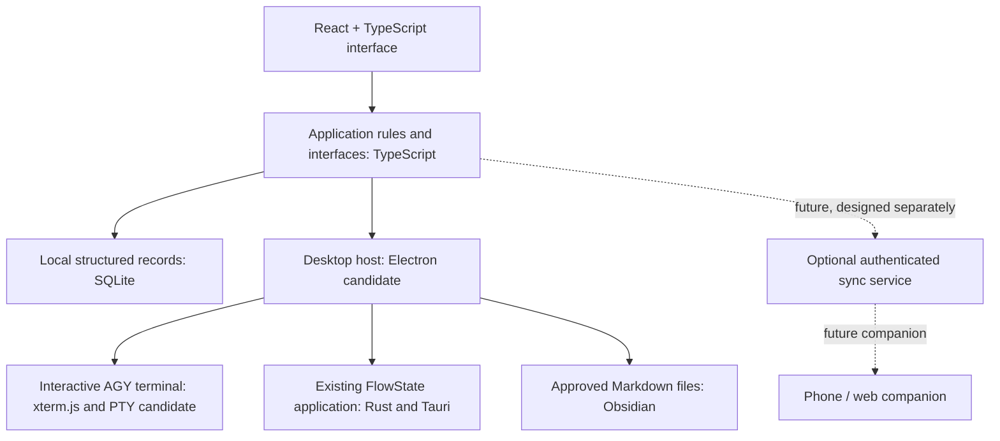

# Stack recommendation — Personal Command Center

**Status:** User accepted the recommended stack direction on 6 November 2026. Production implementation and the verification gates below remain outstanding.  
**Context:** [Project hub](project-hub.md), [first-release plan](first-release-plan.md), [desktop research](desktop-stack-research.md).

## Recommendation

Use **React + TypeScript + Vite** for the dashboard interface and shared application logic, with **Electron + Node.js/TypeScript** for the Windows desktop shell. Use **SQLite** for structured local data, normal Markdown for approved Obsidian reviewers, and evaluate **xterm.js + node-pty** for the real embedded AGY terminal. Keep the existing FlowState app in its current **Tauri + React + Rust** stack and develop a secure integration between the applications; selecting a different dashboard shell does not require rewriting it.

Why this fits: the user knows and wants to learn the React/TypeScript ecosystem, the new dashboard needs to manage a real local terminal and files, and an earlier AGY experiment already used xterm.js and node-pty under Node. Keeping most new feature code in one language may make it easier for the user and agents to follow; that is an engineering judgment, not a measured productivity result. This is a recommendation, not a claim that Electron has zero native code or that every integration is solved.

The user accepted this direction; dependency versions, UI/logic boundaries, production packaging, and integration details still need design and verification. React, TypeScript, and portable data rules keep the UI less coupled to the shell.

## New local smoke tests

- **Electron 44.10.2:** A basic renderer and synthetic command-shell roundtrip through xterm.js and node-pty passed. An actual AGY request using `gemini-3.8-flash-low` initially timed out after 75 seconds. After the synthetic test was changed to wait for AGY's visible input prompt before sending text, the real AGY session returned the expected synthetic answer in the xterm buffer. Input timing is a plausible cause of the earlier timeout but not conclusively established. The passing test used a hidden, unpackaged window with sandboxing enabled, not a visual or release-security check. Its child test process tree required explicit cleanup.
- **Electron 40.10.6:** The same kind of test received an actual AGY response in the xterm buffer. Electron 40 is outside the supported release window at this date, so this proves feasibility only and is not a production version recommendation. [Electron supports its latest three stable major versions](https://www.electronjs.org/docs/latest/tutorial/electron-timelines); its [release list](https://releases.electronjs.org/releases/stable) showed stable versions 43–45 during the check.
- **Electron 45.2.3:** The native terminal module loaded and ran a synthetic command in the main process, but even a trivial renderer crashed with exit `0x80000003`; root cause was not established. Do not infer the dashboard would necessarily fail on all setups.
- **Tauri 2.12.2:** A minimal app rendered xterm.js and received a synthetic command-shell marker via a separate Node/node-pty test helper. This did not exercise AGY, a Rust PTY, packaging, interactive resize, or secure production IPC. The build reused an isolated FlowState test target and recompiled dependencies, so there is no fair size/build-time comparison.
- Tests used disposable data and stopped processes. Their debug artifacts and downloaded runtimes remain in `work/`; Electron downloads may have populated its usual download cache. The prototypes are not packaged apps or security reviews.

## Product architecture

The diagram expresses responsibilities, not a final API or promise of automatic cloud sync. FlowState remains the source of authoritative focus time and session identities. Project-aware MCP is needed for AGY communication and must enforce scoped actions and reviewed changes. The user's original FlowState data and existing vault need safe migration/recovery procedures.

## Compare the realistic choices

| | Electron + React + TypeScript | Tauri + React + TypeScript + Rust |
|---|---|---|
| New dashboard code | Most UI and host logic can use TypeScript/Node. | React/TypeScript UI plus Rust core and IPC; a Node sidecar is another option. |
| AGY terminal | Browser/Node proof and supported Electron 44 prototype ran actual AGY after an initial timed-out test was corrected to wait for a prompt. Packaged app remains untested; node-pty is a native addon. | A Tauri renderer displayed a synthetic terminal marker through a Node helper. AGY in Tauri and a Rust PTY are untested. |
| Storage and runtime | Electron bundles Chromium and Node, so the delivered app is generally larger; JavaScript caches and native builds also use disk. Measure the actual result. | Uses the OS WebView2 by default on Windows, which can make the delivered app smaller. Rust build artifacts can be large; current FlowState builds already show that on this PC. |
| Existing FlowState | Remains a separate Tauri/Rust app; a safe communication boundary is needed. | Same broad technology as FlowState, but a second app does not automatically gain access to FlowState's internal state; a safe boundary is still needed. |
| Main tradeoff | Lower language count and alignment with the Node terminal proof versus heavier runtime and native addon packaging. | Smaller possible runtime and stack consistency with FlowState versus Rust/IPC complexity and build cache. |

[Electron's native-module documentation](https://www.electronjs.org/docs/latest/tutorial/using-native-node-modules) notes that native addons may need Electron-compatible binaries or rebuilding. [Tauri's architecture](https://v2.tauri.app/concept/architecture/) and [Windows installer documentation](https://v2.tauri.app/distribute/windows-installer/) explain its Rust/webview architecture and WebView2 choices. Both require careful local-process and data safety; neither is automatically secure.

A browser-only dashboard plus a local service is also possible, but it needs a privileged helper for a real terminal, files, and FlowState, plus a secure startup/reconnect lifecycle. It does not make the native integration disappear; it is not the leading choice at this stage.

## Disk findings on this PC

Measured during planning; numbers are approximate and will change:

- During research, C: had **21.2 GiB free** and D: had **212.8 GiB free**. The user subsequently clarified that D: is an unstable external HDD and is unsuitable for development. A Windows volume classification did not establish its reliability; do not choose D: for project or build files. The user has since managed storage.
- Existing FlowState's Rust `target` directory: **4.94 GiB**. An isolated copied FlowState test target: **3.71 GiB**. These are development artifacts, not the installed app size or a fair comparison with an Electron build.
- FlowState `node_modules`: **0.139 GiB**; the existing npm cache: **3.91 GiB**. Node tooling also has substantial caches, and these different folders are not a controlled full-stack benchmark.
- [Cargo supports a configurable target directory](https://doc.rust-lang.org/cargo/reference/config.html), but D: must not be used for development. Changing settings, moving existing files, or deleting caches has not been done. Parallel worktrees need a tested strategy for build locks and output isolation; simply sharing a target folder is not automatically safe.

## Future phone and cloud

- Keep the first release Windows-first and usable locally. A later web companion can potentially reuse some React UI; a React Native companion can potentially reuse portable TypeScript logic but generally needs its own native UI. Do not choose a mobile framework until there is an actual mobile workflow.
- Give important records stable identifiers and use versioned data formats and migrations. Keep desktop-only APIs for the AGY process, FlowState, and file access behind interfaces so they do not contaminate portable rules.
- A phone does not automatically have access to the PC's terminal, local FlowState, or Obsidian vault. Remote control or data access would require the PC to be available or a separately designed service with authentication and user consent.
- A real sync design must address offline edits, conflict resolution, deletions, backups/recovery, privacy, and what is shared. SQLite alone does not provide sync; do not synchronize a live WAL-mode SQLite database file between devices. [SQLite documents the same-host constraints of WAL](https://sqlite.org/wal.html). No cloud provider is selected.

## Verification gates for the agreed stack

1. The supported Electron 44 AGY smoke test passed after waiting for the real prompt, but the exact initial timeout cause and the Electron 45 renderer crash are not established. Investigate the 45 compatibility issue before upgrading, and verify an actively supported version as dependencies evolve. A Tauri+Node synthetic marker has passed; Tauri with real AGY or a Rust PTY remains untested.
2. Before production, verify an actual AGY session in the chosen packaged shell: resize, keyboard/clipboard, session resume, failure handling, and appropriate process security. Compare the prototype with the existing browser/Node proof without claiming a fair full-build benchmark.
3. Prove an authenticated, limited FlowState integration and independently verify start, stop-without-completing, restart, timing, and duplicate prevention. The old unauthenticated test bridge is not shippable.
4. Test reviewed Obsidian writes, external-edit conflicts, interrupted writes, and backup/restore against disposable vaults before the real vault. Compare the chosen SQLite binding's version and native packaging to the selected Electron release.
5. Once the app has a real baseline, measure development storage, packaged size, idle RAM, and responsiveness on this PC. If Electron proves too costly or the terminal cannot be packaged reliably, reassess Tauri or a local helper using the same feature requirements. The earlier numbers alone cannot settle that comparison.

## Work split

After the user reviews the choice, define a small shared contract and synthetic fixtures. A UI track owns screen design and states; a logic track owns persistence and behavior behind that contract; the lead integrates and tests both. Worktrunk worktrees isolate source changes, but do not automatically isolate ports, databases, app state, or build caches. See [development orchestration](development-orchestration.md).
